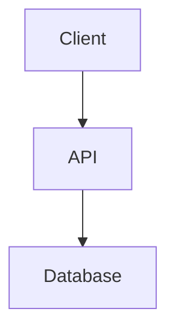

# 🚀 \[Project Name\]


---

## 🧠 Description

\[Short project description: purpose, target audience, and the problem
it solves.\]

---

## 🧩 Table of Contents

- [Description](#-description)
- [Features](#-features)
- [Technologies Used](#-technologies-used)
- [Architecture](#-architecture)
- [Project Structure](#-project-structure)
- [Installation](#-installation)
- [Execution](#-execution)
- [Configuration](#-configuration)
- [Main Endpoints](#-main-endpoints)
- [Usage Examples](#-usage-examples)
- [Screenshots / Demo](#-screenshots--demo)
- [Tests](#-tests)
- [Documentation](#-documentation)
- [Deployment](#-deployment)
- [Known Issues / ToDo](#-known-issues--todo)
- [Learnings & Future Improvements](#-learnings--future-improvements)
- [Contributing](#-contributing)
- [Credits](#-credits)
- [License](#-license)
- [Author](#-author)

---

## 🌟 Features

-   [x] \[Feature 1\]
-   [x] \[Feature 2\]
-   [ ] \[Future feature\]

---

## ⚙️ Technologies Used

**Languages:** \[Java, Python, C#, C++, etc.\]\
**Frameworks:** \[Spring Boot, FastAPI, Unity, Godot, etc.\]\
**Databases:** \[MySQL, PostgreSQL, MongoDB, etc.\]\
**Tools:** \[Git, Docker, Linux, Notion, Swagger, Postman, etc.\]\
**Infrastructure:** \[AWS, Azure, Render, Netlify, etc.\]

---

## 🏗️ Architecture

\[Describe the architecture pattern used in your project\]

-   **Architecture Pattern:** \[e.g., RESTful layered architecture, MVC, Microservices, etc.\]
-   **Database Integration:** \[Database / ORM / Framework\]
-   **Dependency Management:** \[Maven / Gradle / Pip / npm / etc.\]
-   **Deployment Strategy:** \[Docker / CI-CD pipelines / Cloud Services\]



---

## 📂 Project Structure

```
/[root_folder]
 ├── [folder_name]/
 │   ├── [file_or_subfolder]
 │   └── [file_or_subfolder]
 ├── [another_folder]/
 │   ├── [file]
 │   └── [file]
 ├── [config_file]
 └── README.md
```

---

## 📦 Installation

### Prerequisites

Before you begin, ensure you have the following installed:

-   **\[Language / Framework\]** version \[X.X or higher\]
-   **\[Database / Environment\]** version \[X.X or higher\] (if applicable)
-   **Git**
-   **\[Other tools\]** (if applicable)

### Steps

``` bash
git clone https://github.com/[username]/[repo_name].git
cd [repo_name]
```

Install dependencies:

``` bash
[mvn install / pip install -r requirements.txt / npm install]
```

---

## ▶️ Execution

### Local

``` bash
[mvn spring-boot:run / python main.py / ./run.sh]
```

### Docker

``` bash
docker build -t [image_name] .
docker run -p [local_port]:[app_port] [image_name]
```

---

## ⚙️ Configuration

\[Describe configuration requirements for your project\]

Create a `.env` file based on `.env.example`:

``` env
[ENV_VARIABLE_1]=[value]
[ENV_VARIABLE_2]=[value]
[ENV_VARIABLE_3]=[value]
```

---

## 🧩 Main Endpoints

| Method | Endpoint | Description |
|--------|----------|-------------|
| GET | `/api/[resource]` | \[Description\] |
| POST | `/api/[resource]` | \[Description\] |
| PUT | `/api/[resource]/{id}` | \[Description\] |
| DELETE | `/api/[resource]/{id}` | \[Description\] |

---

## 🧪 Usage Examples

\[Provide clear examples of how to use your project\]

``` bash
[command or code example]
```

**Example output:**
```
[expected output]
```

---

## 📸 Screenshots / Demo


---

## 🧾 Tests

Unit / integration tests:

``` bash
[mvn test / pytest / npm test]
```

Coverage:

``` bash
[mvn jacoco:report / coverage run -m pytest]
```

---

## 📖 Documentation

\[Describe where to find additional documentation\]

The complete code documentation \[is generated with \[tool\] / can be found at\]:

🔗 **[Documentation Link](\[URL\])**

\[Optional: Instructions to generate documentation locally\]
```bash
[command to generate docs]
```

The documentation includes:
- \[Key documentation sections\]
- \[What users can find\]
- \[Other relevant information\]

---

## 🚀 Deployment

\[Describe how to deploy your project\]

**Platform:** \[Render / AWS / Azure / Netlify / Heroku / etc.\]

### Deployment Steps:

1. \[Step 1\]
2. \[Step 2\]
3. \[Step 3\]

**Environment variables:** Make sure to configure all required environment variables in your deployment platform.

\[Optional: Docker deployment instructions\]
```bash
docker-compose up -d
```

---

## 🐞 Known Issues / ToDo

| Status | Task | Priority |
|--------|------|----------|
| 🟡 | \[Task description\] | Medium |
| 🟢 | \[Task description\] | Low |
| 🔴 | \[Task description\] | High |

---

## 🧭 Learnings & Future Improvements

\[Summary of learnings, challenges, and next steps.\]

---

## 🤝 Contributing

Contributions are welcome! If you'd like to contribute to this project, please follow these steps:

1. **Fork** the repository
2. **Create** a new branch (`git checkout -b feature/YourFeature`)
3. **Commit** your changes (`git commit -m 'Add some feature'`)
4. **Push** to the branch (`git push origin feature/YourFeature`)
5. **Open** a Pull Request

Please make sure to:
- Follow the existing code style
- Write clear commit messages
- Add tests for new features
- Update documentation as needed

---

## 🤝 Credits

-   \[Names or references\]
-   \[Repos or tutorials used\]
-   \[External assets or libraries\]

---

## 📜 License

This project is licensed under the \[License Name\] License - see the [LICENSE](LICENSE) file for details.

\[Optional: Brief explanation of what the license allows\]

---

## 👩‍💻 Author

**Lilith Estévez Boeta**  
💻 Backend & Multiplatform Developer  
📍 Málaga, Spain

🔗 [GitHub](https://github.com/Alelith) | [LinkedIn](https://www.linkedin.com/in/alelith/)

---

<p align="center">
  <b>⭐ If you like this project, don't forget to leave a star on GitHub ⭐</b>
</p>
