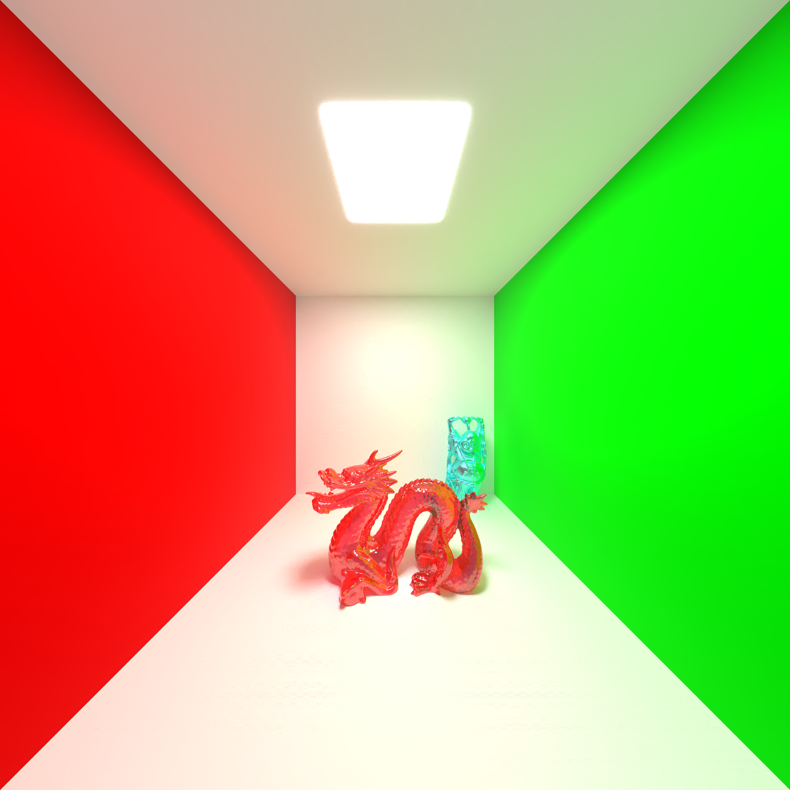
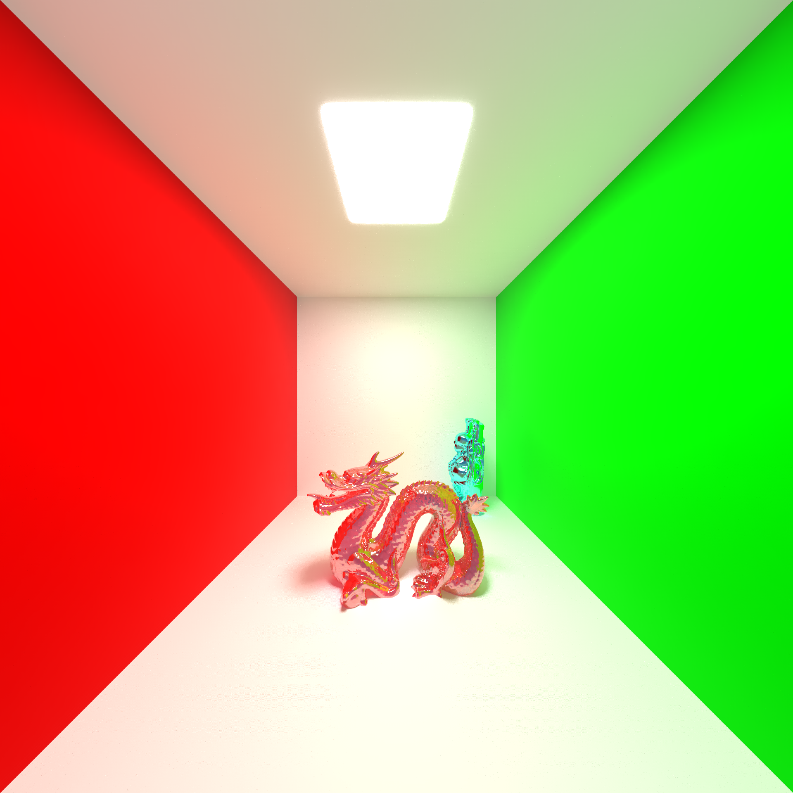
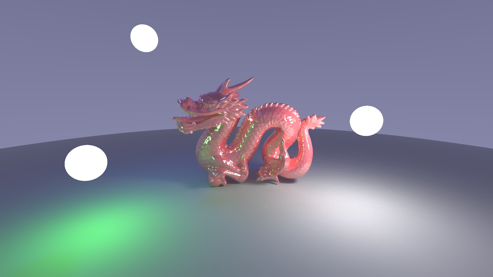

# 🚀 Ray Tracer


---

## 🧠 Description

A high-performance Ray Tracer built from scratch using C++ and CUDA, leveraging GPU parallel processing to render 3D scenes. It features support for geometric primitives, mesh rendering, linear bounding volume hierarchies (BVH), and physically based routing materials.

---

## 🧩 Table of Contents

- [Description](#-description)
- [Features](#-features)
- [Technologies Used](#-technologies-used)
- [Project Structure](#-project-structure)
- [Installation](#-installation)
- [Execution](#-execution)
- [Usage Examples](#-usage-examples)
- [Screenshots / Demo](#-screenshots--demo)
- [Known Issues / ToDo](#-known-issues--todo)
- [Credits](#-credits)
- [License](#-license)
- [Author](#-author)

---

## 🌟 Features

-   [x] Hardware-accelerated GPU path tracing using CUDA
-   [x] Basic primitives geometry (Spheres, Cones, Cylinders, Tori, Triangles, Quads)
-   [x] Advanced `.obj` mesh loading
-   [x] Linear Bounding Volume Hierarchy (BVH) for accelerated intersection testing
-   [x] Custom `.lrtc` scene description format parsing
-   [x] Physically Based Rendering (PBR) materials (Albedo, Roughness, Metalness, Transmission, Emission)
-   [ ] Temporal / Spatial Denoising filtering
-   [ ] Additional texture formats support

---

## ⚙️ Technologies Used

**Languages:** C++17, CUDA C++  
**Libraries:** SDL2, stb_image, stb_image_write  
**Tools:** Git, Make, NVCC (Nvidia CUDA Compiler)  
**Hardware:** Dedicated Nvidia GPU

---

## 📂 Project Structure

```text
/ray-tracer
 ├── include/
 │   ├── debug/     # Timing, PNG saving, and PPM printing
 │   ├── geometry/  # AABB, BVH, bounding shapes and primitive intersections
 │   ├── maths/     # 3D vectors, matrices, solvers, random streams and rays
 │   ├── parsing/   # Scene and OBJ parsers
 │   └── render/    # Camera, Material, Textures
 ├── res/
 │   ├── meshes/    # 3D .obj models
 │   ├── scenes/    # .lrtc scene definition files
 │   └── textures/  # PBR textures
 ├── src/           # CUDA implementation files (.cu)
 ├── renders/       # Final rendered images output
 ├── Prompts/       # AI guidelines and templates
 ├── Makefile
 ├── LICENSE
 └── README.md
```

---

## 📦 Installation

### Prerequisites

Before you begin, ensure you have the following installed:

-   **NVIDIA CUDA Toolkit**
-   **C++17 Compatible Compiler** (e.g., GCC or Clang)
-   **Make**
-   **SDL2 Library** (`libsdl2-dev` on Debian/Ubuntu, `sdl2` on Arch Linux)

### Steps

``` bash
git clone https://github.com/Alelith/ray-tracer.git
cd ray-tracer
```

Compile the project:

``` bash
make
```

---

## ▶️ Execution

### Local

You can execute the ray tracer by passing a scene configuration file (`.lrtc`) as an argument:

``` bash
./ray_tracer res/scenes/04_cornell_box.lrtc
```

---

## 🧪 Usage Examples

To render a scene, simply call the executable with one of the available scenes in the `res/scenes/` directory.

``` bash
./ray_tracer res/scenes/04_cornell_box.lrtc
```

**Example output:**
```
Cámara configurada correctamente (1920 px, FOV 120)
Quad creado correctamente en la línea 11
Quad creado correctamente en la línea 14
Quad creado correctamente en la línea 17
Quad creado correctamente en la línea 20
Quad creado correctamente en la línea 23
Quad creado correctamente en la línea 27
Modelo OBJ parseado e importado correctamente en la línea 29
Modelo OBJ parseado e importado correctamente en la línea 31
Creating BVH...
```

---

## 📸 Screenshots / Demo

*All the following renders were executed on a system with an **Intel i5 10th Gen CPU** and an **NVIDIA GTX 1650 GPU**.*

### Cornell Box
- **Samples:** ~10,000
- **Render Time:** ~5 hours
<br>

<div align="center">
  
  
</div>

### Dragon
- **Samples:** ~10,000
- **Render Time:** ~45 minutes
<br>

<div align="center">
  
</div>

---

## 🐞 Known Issues / ToDo

| Status | Task | Priority |
|--------|------|----------|
| 🔴 | Refactor architecture from megakernel to wavefront design | High |

---

## 🤝 Credits

- [stb_image](https://github.com/nothings/stb) by Sean Barrett for image loading and saving.
- NVIDIA CUDA Library.

---

## 📜 License

This project is licensed under the GPL-3.0 License - see the [LICENSE](LICENSE) file for details.

The GNU General Public License is a free, copyleft license that requires any modified versions to be explicitly marked as changed and ensures that any derived works remain free and open.

---

## 👩‍💻 Author

**Lilith Estévez Boeta**  
💻 Backend & Multiplatform Developer  
📍 Málaga, Spain

🔗 [GitHub](https://github.com/Alelith) | [LinkedIn](https://www.linkedin.com/in/alelith/)

---

<p align="center">
  <b>⭐ If you like this project, don't forget to leave a star on GitHub ⭐</b>
</p>
